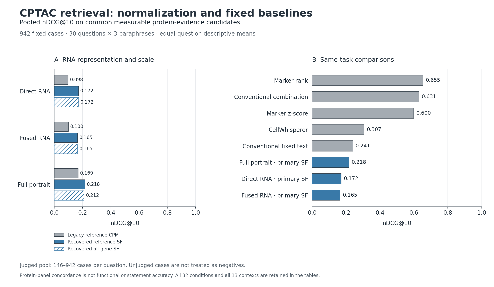

# CPTAC 归一化复评结果

2026-10-13。数值结果可在以下限制下使用；Cell 投稿准备未完成。

归一化修复提高了 pooled 主分析中的 RNA 得分，但没有证明相对于固定强基线的实用增益。结合此前 SDY2823 复评，本阶段未达到原计划的研究推进标准。应保留结果并由作者决定下一研究路线，不继续扩大训练、确认性研究或湿实验投入，也不把格式完善写成已经可以投稿。

## 主要结果

同一组 942 个 CPTAC 病例、30 个问题及每题 3 个改写；各问题的所有方法使用相同的可测蛋白候选池。

| 方法 / 表示 | 旧参考 CPM | 恢复的参考基因 SF | 全测量基因 SF 敏感性 |
| --- | ---: | ---: | ---: |
| Direct RNA | 0.0981 | 0.1716 | 0.1717 |
| Fused RNA | 0.1003 | 0.1655 | 0.1645 |
| 完整 portrait 六字段文本 | 0.1695 | 0.2175 | 0.2116 |

表中为 pooled conditional nDCG@10，先平均每题的三个改写，再平均 30 个问题。旧 CPM 条件保留原名及结果，不改称为训练时的尺度。

同任务固定基线为 marker-rank **0.6546**、传统组合 **0.6310**、marker-zscore **0.5997**、CellWhisperer **0.3070**、传统结果固定文本语义检索 **0.2408**。恢复尺度的完整 portrait 的 Precision@10 为 **0.3500**，marker-rank 为 **0.8000**。这些指标均限定于共有可测蛋白候选池。

完整 portrait 相对旧 CPM 在 30 个问题中改善 18 个、下降 12 个；相对 marker-rank 和传统组合均为 3 胜、27 负；相对 CellWhisperer 为 13 胜、17 负。这些问题共享生物学面板，不能把该计数当成独立重复的显著性检验。

改善也并非覆盖所有分析层次。完整 portrait 的 within-cohort 宏平均从 **0.2872 降至 0.2784**。在 499 个既有交叉表未关联病例中，新 portrait 为 **0.2440**，仍低于 CellWhisperer **0.3025** 和传统组合 **0.6035**。全部 13 个上下文与 32 个新旧条件均保留，未择优替换 pooled 主分析。

## 验收范围

- 3,768 次完整 portrait 推断全部完成，零失败；生成 1,186,920 条新增排名记录。
- 独立实现重建 37,440 组指标，最大绝对数值差 **4.45×10⁻¹⁶**；12,480 组改写稳定性也核对通过。
- 原有 21,060 组指标复算一致；旧输出、输入、模型源码和权重未覆盖。
- 两种 SF 条件下，校准开启/关闭后的六字段文本分别均为 **942/942 完全一致**；这不等于所有内部校准变量都相同。
- 主尺度生成 821 种不同文本，敏感性尺度 818 种。Exact-tie 处理后的主 portrait nDCG 为 **0.2181**，不改变结论。

完整数表见 [全部条件](primary_all_conditions.csv)、[分层比较](prespecified_comparators_by_context.csv)、[逐问题差异](paired_question_comparisons.csv)；[六单元 notebook](CPTAC_Normalization_Reassessment.ipynb)已执行。图为探索性分析记录，不是原计划六个投稿主图的替代品。

## 解释边界

每题可判断病例为 **146–942**，测量缺失并非随机。主 portrait 的全候选池 top-10 已判断比例平均为 **0.7678**；不能把其余病例当作错误，也不能把 conditional Precision/nDCG 冒充全库准确率。

传统结构化基线接收固定的 `positive_features` / `negative_features` 查询—面板映射，并在三个改写中复用相同评分。因此其 Jaccard=1 是该输入接口的结果，不证明它理解自由文本。它们是已有分析流程的强任务参照；与直接接收文本的模型比较时必须说明这一额外输入。蛋白评价也采用预定面板，不能将本比较外推为开放式生物学问答的通用排行榜。

原始蛋白丰度是与 RNA 分开的测量，但面板只是分子代理证据，不是细胞计数、功能、机制或真实评价者的逐句判断。本轮仍未完成独立人工语句盲评。

单次 selected-gene shuffle 的 direct RNA nDCG 为 **0.1868**，全局错配为 **0.2185**，正常 direct RNA 为 **0.1716**。这是预定单次随机对照，不能据此宣称稳定的打乱优势或模型不依赖表达。所有屏蔽和错配结果已保留；未因不利而移除。

SF 在全体 942 个候选上联合拟合，属于传导式预处理，不是训练集冻结的单样本部署接口。443 个已知 test 病例和 499 个未关联病例也不等于严格的新患者或未暴露外部队列。原 anchor 主干的归档 sidecar 已单独恢复并交叉核验，但这不解决所有后续 heads/priors/规则的暴露历史。

完整推断耗时约 4,187 秒，其间存在独立核查工作负载；该壁钟时间不作为隔离的端到端速度比较或“节省人工核查成本”的证据。

## 证据与下一步

本结论来自冻结的查询、输入和蛋白规则，以及逐组独立复算；不是从单个成功样本或一个平均分推导的新生物学发现。它支持“当前方案尚未证明该检索场景的增量价值”，不支持“研究方向永远不可行”或任何 Cell 接受率估计。

按原计划应在此设置决策点：由作者选择先重新定义模型目标与新的留出验证协议，或调整论文定位及目标期刊。两者都不应通过删去本轮阴性结果完成。

当前正文仍为 v1.12，作者信息及原提交版保持不变。新结果尚未写回 Word；确认性证据、人工盲评、六个新主图和最终 Cell 投稿附件均不能标为完成。本次没有启动新训练、合并 main 或提交稿件。
