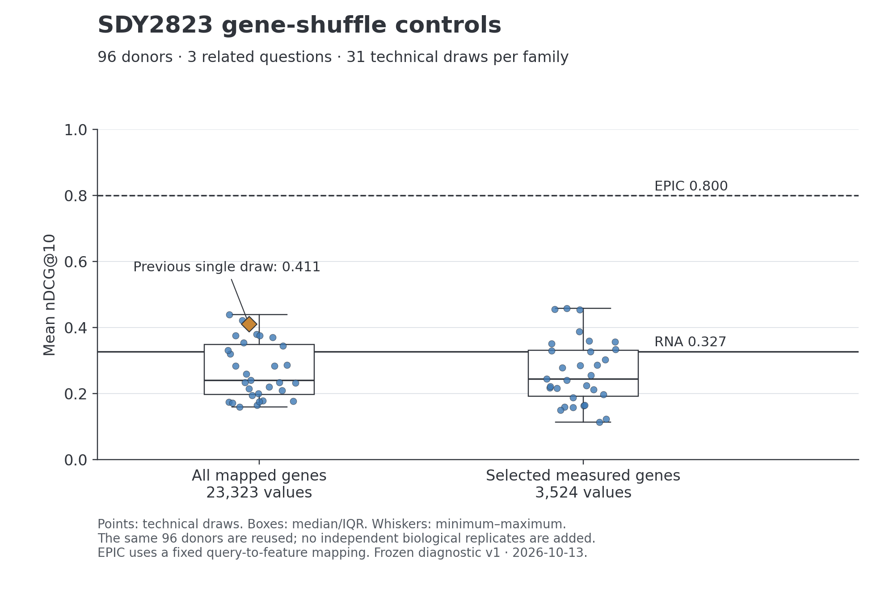

# SDY2823有限失败诊断

本轮是观察到既有结果后的、有界事后诊断，不是确认性研究。96位供者、3个有独立流式相关性等级的问题、查询、模型和主归一化输入均保持不变；没有训练、调参、增加独立供者或替换旧结果。

## 主要发现

| 比较 | 结果 | 可以支持的判断 |
| --- | --- | --- |
| 原始RNA直接检索 | 平均nDCG@10为0.327486 | 在同一三题候选池上的观测值，不是一般生物学准确率 |
| 全映射基因打乱，31个固定种子 | 中位数0.239619；范围0.159748–0.439131；10/31次不低于原始RNA | 原来0.411080的单次高值不能代表整个控制分布 |
| 仅实测模型特征打乱，31个固定种子 | 中位数0.244336；范围0.113441–0.457968；9/31次不低于原始RNA | 保留特征值分布后仍有明显重叠，不能把原对照问题全部归于特征零值比例变化 |
| 条件随机排序 | 解析均值0.292824；原始RNA的2.5%–97.5%重排参考范围约0.172–0.429 | 0.327落在该描述性参考范围内；不报告一般性优越性P值 |
| 本队列RNA表示 | 旧CPM与恢复归一化的中心化参与率维数均约1.04，第一主成分约占98% | 变化集中于单一方向，且现象不是本次归一化新造成的；不能外推为模型全局失效 |
| T/B查询得分 | RNA直接空间Spearman约0.943，完整portrait约0.984；EPIC约0.395 | 本队列相关查询的得分缺乏细粒度区分，是线索，不是已定位的唯一原因 |

全部30题的描述性“改写内余弦均值减去题目质心间均值”由0.147增至0.215，不能将失败简单归结为所有文本查询投影塌缩。这个几何量也不是语义准确率。原始RNA在三题内的改写top-10 Jaccard均值约0.179，较高的向量相似度并不保证相同候选。

已映射模型特征的零值比例中位数约73.9%，不等于映射失败。未解析的572个位置另计。全映射打乱后特征零值中位数约39.0%，实测特征打乱保留约73.9%。原始输入没有发生±8裁切；打乱条件中最大仅1/3,524个实测特征发生上限裁切。不能把两种打乱混作一种干预，也不能从中位表达值都为0推断两种归一化数值相同。

图中箱体为中位数/四分位范围，须线为最小—最大值，不是置信区间。62个点是技术重复，复用同一96位供者和3个相关问题。EPIC使用固定查询—特征映射，不是无限制自然语言解析器。

## 证据到结论，再到下一步

- 原推断重现：Linux与Mac的原始RNA和原种子对照，18组top-10顺序全部相同；嵌入最大差异低于9e-8，得分最大差异约3e-7。不是迁移导致排名突变。
- 数值核验：5,670组新得分矩阵重构误差0；567组控制指标独立核验最大误差约2.22e-16。
- 随机参考：10,000个供者标签置换全部是双射；对20个固定抽样索引×27方法直接重算，共540组，差异约2.22e-16。它只刻画条件随机赋值参考，不能当作新队列不确定性或一般性P值。
- 几何核验：以Gram矩阵特征值独立复核SVD参与率，最大差异约3.55e-15；查询得分相关系数以秩后Pearson独立复核。
- 研究判断：单次打乱的解释得到修正，但实用检索门槛并未通过。没有定位唯一原因，不直接扩大确认性或湿实验投入。
- 原计划尚欠：应在已有CPTAC候选池上完成正确尺度的冻结模型复评，保留SDY阴性结果，不新增有利问题或为了改善数字选择数据集。这个既定探索性复评与扩大确认性研究不同。

## 复核入口

[PROTOCOL.json](PROTOCOL.json)在运行前固定控制定义、种子、随机标签参考和诊断范围；此前结果已知，因此没有预注册声明。先保存全部新向量和查询得分，再访问评价标签。

执行順序为`run_control_inference.py`、`analyze_controls.py`、`verify_diagnostic.py`、`build_notebook.py`。代码接受显式研究目录与新输出目录；需要保留的研究目录布局、冻结紧凑模型和相应本地rc4接口。完整参与者级输入/向量未随这个代码与汇总补丁发布。不要把公开仓库单独视为完整研究包。

- [执行并复核的Notebook](SDY_Failure_Diagnostic.ipynb)：9个代码单元，含全部关键检查、表格和图。
- [分析摘要](analysis_summary.json)、[推断摘要](inference_summary.json)、[独立核验](independent_validation.json)。
- [所有控制与改写指标](control_metrics_all_variants.csv)、[每个种子的三题均值](control_replicate_means.csv)、[全部27方法的标签重排参考](sample_label_randomization_summary.csv)。
- [RNA表示几何](embedding_geometry.csv)、[全部查询对几何](query_pair_geometry.csv)、[查询间得分关系](cross_query_score_correlations.csv)、[输入摘要与得分相关性](score_input_correlations.csv)。

输出保存到新版本目录；无失败样本被删除，无最优种子被筛选，旧文件和原稿保持不变。常数相关性保留为缺失值，不填0。公开内容不包含参与者级数据、模型权重或凭据。

## 交付与限制

采用可执行Notebook和作者审阅用静态图件，不另建HTML报告。`build-report`技能在当前环境中不可用；图件按已选定的研究文件/Notebook输出制作。它不是原计划主文图件的自动替换，也不完成Cell投稿科学门槛。

独立人工语句盲评、训练划分溯源、单样本部署参考及新的留出队列实用收益仍未完成。队列内低维表示、稀疏特征和得分相关性是需要解释的现象，不能单独证明技术错误、具体机制或模型在所有任务上失效。
